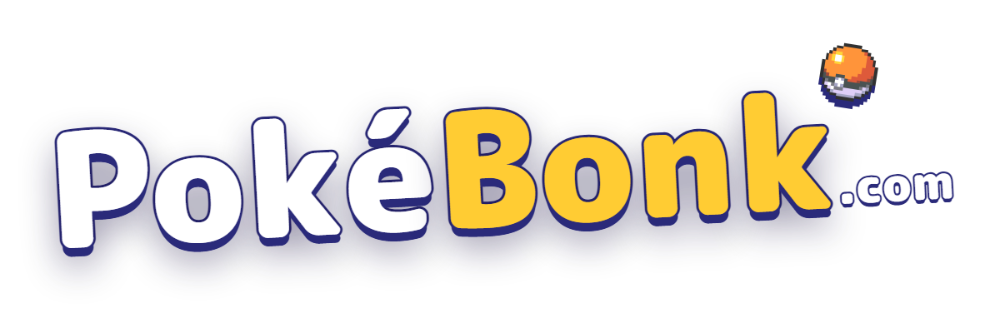

<div align="center">



### Survivor 3D Pokémon gratuit, directement dans le navigateur

**Survis aux hordes sauvages, fais évoluer ton équipe, déclenche ton Ultime et grimpe dans la Ligue.**

[](https://pokebonk.com)
[](https://discord.gg/X7KusQqx8X)


</div>

---

## ✨ Le jeu

PokéBonk est un **fan-game de type survivor** (à la *bullet heaven*) en 3D, jouable sans rien installer, sur ordinateur comme sur mobile.

- 🎮 **Les 151 Pokémon de Kanto** : choisis ton partenaire, fais-le évoluer en cours de partie.
- ⏱️ **Mode classique** : survis 10 minutes et affronte les boss sauvages.
- ♾️ **Mode Survie** : une partie sans fin pour battre ton record.
- 💥 **Ultime** : se charge en mettant des Pokémon K.O., se déclenche avec <kbd>Espace</kbd>.
- 🗺️ **8 régions** : forêt, désert, côte, glacier, caverne et bien d'autres.
- 🏆 **Ligue et classements par saison**, avec tes meilleurs scores sauvegardés.
- 👤 **Joue en invité tout de suite**, puis transforme ton profil en compte en un clic.
- 🌍 **5 langues** : français, anglais, espagnol, portugais et allemand.

## 🚀 Lancer le projet en local

**Prérequis :** [Node.js](https://nodejs.org) **22.13 ou plus récent** (le serveur utilise le module intégré `node:sqlite`).

```bash
git clone https://github.com/Creaios/pokebonk.git
cd pokebonk
npm install
```

**Développement** (front seul, rechargement à chaud) :

```bash
npx vite
```

**Production** (site + API + base SQLite, sur <http://localhost:8787>) :

```bash
npm run build
npm start
```

### Variables d'environnement

| Variable | Rôle | Par défaut |
| --- | --- | --- |
| `PORT` | Port du serveur | `8787` |
| `DB_PATH` | Chemin de la base SQLite | `data/pokebonk.db` |
| `PUBLIC_URL` | URL publique du site (liens de réinitialisation) | hôte de la requête |
| `SMTP_HOST`, `SMTP_PORT`, `SMTP_USER`, `SMTP_PASS`, `SMTP_FROM` | Envoi des e-mails (SMTP over TLS) | lien affiché dans la console |

## 🗂️ Structure

```
├── index.html          Page d'accueil et écran de connexion
├── legal.html          Mentions légales et confidentialité
├── src/
│   ├── main.js         Point d'entrée du front
│   ├── api.js          Client de l'API (comptes, parties, classements)
│   ├── i18n.js         Traductions
│   └── game/           Moteur de jeu, menus, Pokédex, boss, biomes…
├── public/assets/      Sprites, portraits, modèles 3D, icônes
└── server/index.js     Serveur Node : fichiers statiques + API + SQLite
```

## 🛠️ Technologies

- **[Three.js](https://threejs.org)** pour le rendu 3D en WebGL
- **[Vite](https://vitejs.dev)** pour le build du front
- **Node.js** sans framework : `node:http`, `node:sqlite`, `node:crypto` (mots de passe hachés avec scrypt)

## 💬 Communauté

Des idées, un bug, ou envie de partager ton record ? Rejoins le **[Discord PokéBonk](https://discord.gg/X7KusQqx8X)**.

Créé par **[Charcher](https://x.com/ImCharcher)**.

---

<div align="center">
<sub>
Fan-game non officiel, gratuit et sans but lucratif. Non affilié à Nintendo, The Pokémon Company, Creatures Inc. ni GAME FREAK inc.<br>
Pokémon et les noms des personnages sont des marques de leurs détenteurs respectifs.<br>
Demande de retrait de contenu : <a href="mailto:contacto@pokebonk.com">contacto@pokebonk.com</a>
</sub>
</div>
